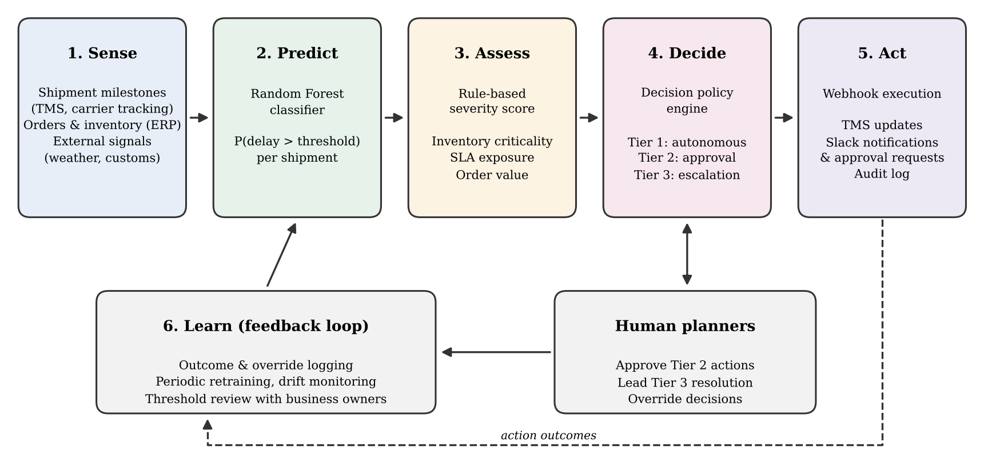

# Tiered-Autonomy Agentic Decision Support for Shipment Delay Exception Management

[](https://doi.org/10.2139/ssrn.7657262) [](https://doi.org/10.5281/zenodo.23571811)

**Author:** Sophia Gazula — Independent Researcher, Chicago, IL · sophiegazula@gmail.com

This repository contains the paper, code, and synthetic data for
*"Tiered-Autonomy Agentic Decision Support for Shipment Delay Exception Management: Architecture and Simulation-Based Evaluation."*

📄 **Paper:** [SSRN](https://papers.ssrn.com/sol3/papers.cfm?abstract_id=7657262) · DOI [10.2139/ssrn.7657262](https://doi.org/10.2139/ssrn.7657262) · [PDF in this repo](paper/Gazula_Agentic_Delay_Resolution_Paper.pdf)

 **Link:**  - ([https://sophiagazula.github.io/agentic-delay-resolution/](https://sophiagazula.github.io/agentic-delay-resolution/)

## Overview

The delay resolution agent predicts international shipment delays, scores their business severity, and acts under a tiered-autonomy policy:

| Tier | Severity | What the agent does |
|---|---|---|
| 1 — Autonomous | S < 0.20 | Updates ETA in the TMS and notifies stakeholders (no spend) |
| 2 — Approval | 0.20 ≤ S < 0.40 | Proposes expedite / reroute / reallocation; planner approves |
| 3 — Escalation | S ≥ 0.40 | Opens an escalation with full context; planner leads |



## Key results (synthetic data, held-out test period Jul–Dec 2025)

| Measure | Manual workflow | Agent workflow |
|---|---|---|
| Delays identified while in transit | 20.7% | 68.1% |
| Mean time to resolution, delayed shipments | 33.8 h | 16.4 h (−51%) |
| Median time to resolution | 30.1 h | 9.7 h (−68%) |
| Planner handling hours | 7,922 | 4,799 (−39%) |

Classifier (Random Forest): precision 0.58, recall 0.68, F1 0.63, ROC-AUC 0.87.
Across staffing and handling-time scenarios, the MTTR reduction ranged from 31% to 93%.

> All data are synthetic. Results illustrate the architecture under stated simulation assumptions and are not measurements from a live deployment. See Section 7 of the paper for limitations.

## Repository structure

```
paper/      Paper (PDF and Word)
src/        experiment.py — data generator, model training, workflow simulation
data/       synthetic_shipments.csv — 48,000 synthetic shipments
results/    results.json — every number reported in the paper
figures/    architecture.png
```

## Reproduce the results

Requires Python 3.10+.

```bash
git clone https://github.com/Sophiagazula/agentic-delay-resolution.git
cd agentic-delay-resolution
pip install -r requirements.txt
python src/experiment.py
```

The script runs in about 3–5 minutes with a fixed random seed. It regenerates `data/synthetic_shipments.csv` and writes `results/results.json`.

## Citation

If you use this work, please cite the paper:

> Gazula, S. (2026). Tiered-autonomy agentic decision support for shipment delay exception management: Architecture and simulation-based evaluation. *SSRN*. https://doi.org/10.2139/ssrn.7657262

To cite the code and data specifically:

> Gazula, S. (2026). *Agentic delay resolution: Code and synthetic data* (Version 1.0.0). Zenodo. https://doi.org/10.5281/zenodo.23571811

A `CITATION.cff` file is included, so GitHub shows a **"Cite this repository"** button.

## License

Code is released under the MIT License. The paper is © 2026 Sophia Gazula.

## Exception console

A working view of the agent's output: the exception queue a planner would open each morning, with the
reasoning behind each alert, the policy settings, and the evaluation from the paper.

**Live:** https://sophiagazula.github.io/agentic-delay-resolution/

| Page | What it shows |
|---|---|
| Exceptions | In-transit shipments flagged by the model, ranked by severity and routed by tier. Click a row to see Sense → Predict → Assess → Decide → Act for that shipment. |
| Activity and overrides | What the agent did, planner approvals and rejections, and rejection rate by carrier (the feedback signal). |
| Policy and thresholds | Move the alert threshold, tier boundaries and severity weights; the 12,056-shipment test set is re-scored live in the browser. |
| Model performance | Rule vs. logistic regression vs. Random Forest, confusion counts, feature importance, calibration. |
| Workflow impact | Simulated planner hours and time to resolution, manual vs. agent, with sensitivity analysis. |
| Architecture and paper | The architecture figure, the paper, and what in the console is illustrative. |

**How it's built.** `console/build.py` runs `src/experiment.py` unchanged, checks that every number in
`results/results.json` is reproduced exactly (the build fails otherwise), then exports the test set,
severity and tiers to `data.js`. Per-shipment risk drivers are tree-path contributions from the Random
Forest; they sum to the predicted probability. The page is static HTML with no framework.

**What's illustrative.** The snapshot time (14 Oct 2025, 10:00), shipment IDs, planner statuses and the
Tier 2 proposed action are added so the queue looks like a working day. Model scores, severity, tiers,
metrics and simulation results all come from the paper's code.

Run locally:

```bash
pip install -r console/requirements.txt
python console/build.py        # ~2.5 minutes; writes _site/
python -m http.server -d _site 8000
```

The GitHub Actions workflow in `.github/workflows/console.yml` runs the same build on every push to
`main` and deploys `_site/` to GitHub Pages.
